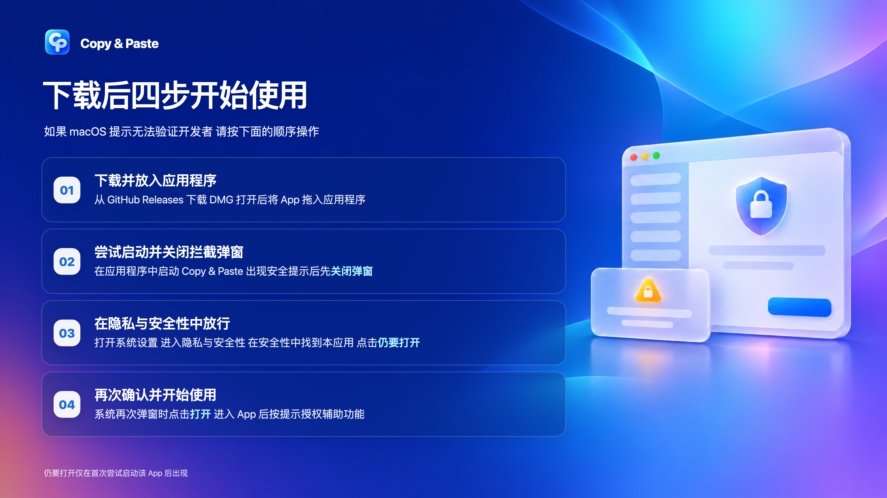
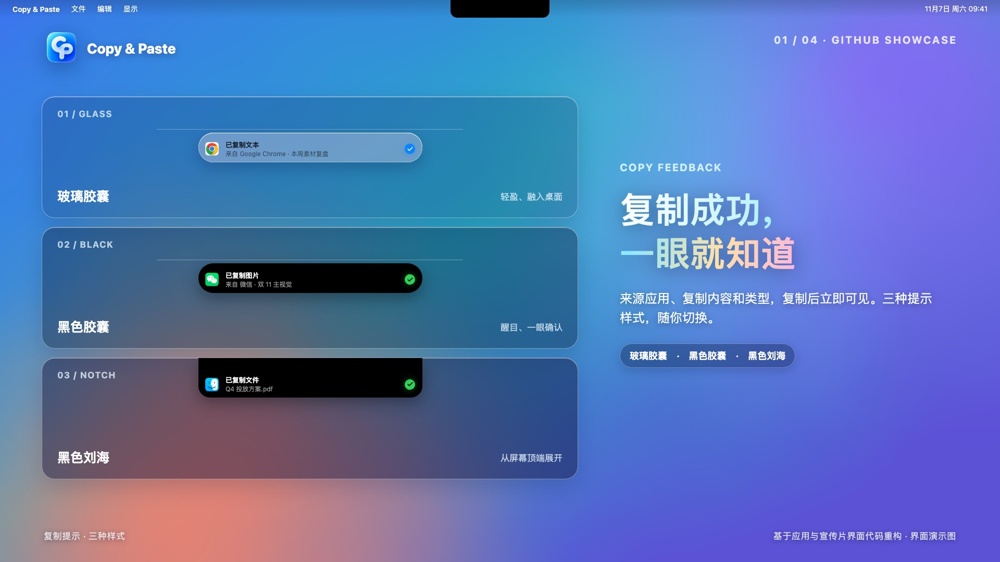
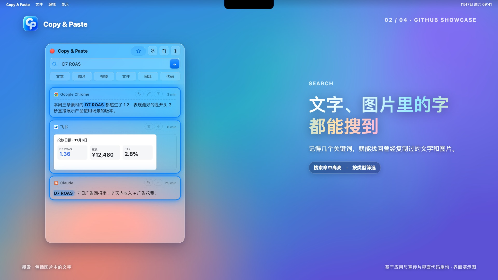
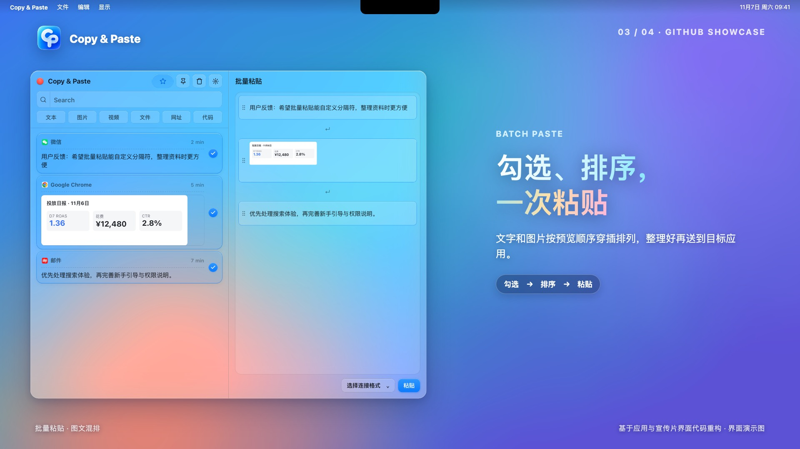
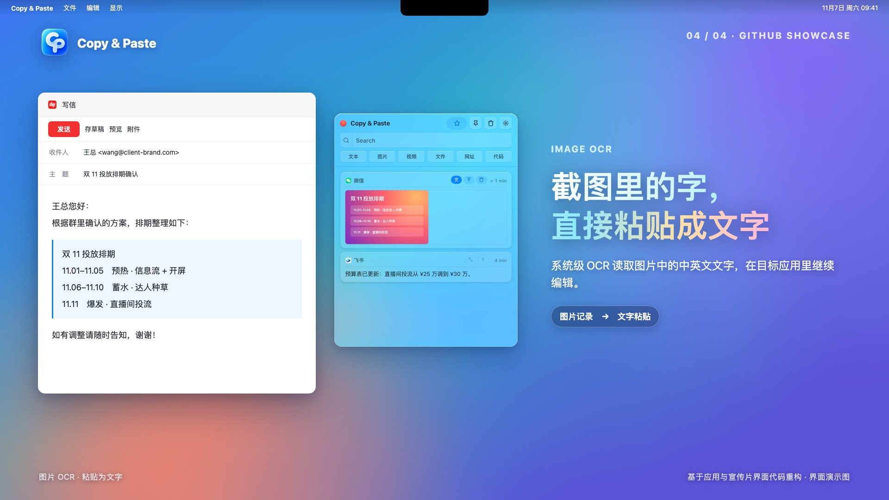

# Copy & Paste

**复制随手，粘贴到位。** 一款专为 macOS 打造、数据保存在本机的开源剪贴板工具。

默认按 `⇧Z` 唤出窗口，查找复制过的文字、图片、文件等内容，点选即可粘贴到正在使用的应用。

## 下载与首次打开

前往本仓库的 [Releases 页面](../../releases)，在对应版本的 **Assets** 中下载 `Copy-and-Paste_1.0.0_aarch64.dmg`。打开 DMG，将 `Copy & Paste.app` 拖入“应用程序”文件夹，再从“应用程序”启动。Release 中自动生成的 **Source code** 压缩包是源码，不能直接作为安装包使用。



当前安装包面向 **Apple 芯片 Mac**，采用 ad hoc 签名，尚未经过 Apple 公证。如果 macOS 阻止打开，请先关闭首次拦截弹窗，再到“系统设置 → 隐私与安全性 → 安全性”中找到这次被拦截的 App，点击“仍要打开”；系统再次弹窗时再点击“打开”。“仍要打开”只会在尝试启动该 App 后出现。详见 [Apple 官方说明](https://support.apple.com/zh-cn/102445)。

## 界面演示

以下图片使用应用界面与宣传片界面的源码、示例数据重新绘制，用于展示功能与视觉风格，并非应用的实际截图。









## 功能

- **自动记录与快速粘贴**：保存文字、富文本、代码、网址、图片，以及从访达复制的视频和文件。默认 `⇧Z` 唤出面板，点击记录即可粘贴。
- **搜索与分类**：按内容、来源应用或图片中识别出的文字搜索；按类型筛选。
- **图片文字识别**：使用 macOS 的 Apple Vision 在本机识别图片中的中英文文字，并可将识别结果粘贴为文字。
- **批量粘贴**：勾选多条记录，在预览中调整顺序与连接格式后粘贴。
- **复制提示**：玻璃胶囊、黑色胶囊、黑色刘海三种样式，可调整停留时间或关闭。
- **常用内容与编辑**：保存常用语和常用图；编辑文字记录，或选择以原格式、纯文本、Markdown 粘贴。
- **系统翻译**：macOS 26 及以上可用 Apple 的本机翻译框架处理中英互译；首次使用可能需要下载系统语言包。

## 系统要求与权限

| 项目 | 要求 |
| --- | --- |
| 系统 | macOS 14 或更新版本 |
| 芯片 | 当前安装包仅提供 Apple 芯片版；Intel Mac 尚未验证 |
| 外观 | macOS 26 使用系统液态玻璃；较早版本使用毛玻璃 |
| 翻译 | 需要 macOS 26 或更新版本 |
| 辅助功能权限 | 用于向其他应用发送粘贴快捷键；首次启动时按应用提示授权 |

## 数据与隐私

剪贴板记录默认保存在 `~/Library/Application Support/com.wangchong.copypaste/`。应用没有账号、云同步或使用情况统计。文字识别和翻译在本机完成；复制网页富文本时，应用可能下载其中的网络图片以保留内容。系统翻译语言包由 macOS 下载和管理。

可以在设置中关闭持久化存储，使记录仅保留在当前会话中。

## 从源码构建

需要 macOS、Node.js、Rust、Xcode，以及构建 Swift 桥接代码所需的 macOS 26 SDK。

```bash
npm ci
npm run tauri:dev     # 开发版，与正式版使用不同的数据目录
npm test              # 前端测试
npm run test:rust     # Rust 测试
npm run lint
npm run tauri:build   # 生成 .app 与 .dmg
```

当前配置使用 ad hoc 签名。若希望用户无需手动放行，可改用 Developer ID 签名并提交 Apple 公证。构建产物位于 `src-tauri/target/release/bundle/`。

## 开源许可与致谢

本项目基于 [TieZ](https://github.com/jimuzhe/tiez-clipboard) 修改，沿用 [GPL-3.0](LICENSE)。本项目重写了 macOS 界面，并移除了云同步、AI 等功能。液态玻璃窗口与 OCR 的实现参考了 [Maccy](https://github.com/p0deje/Maccy)（MIT）。
